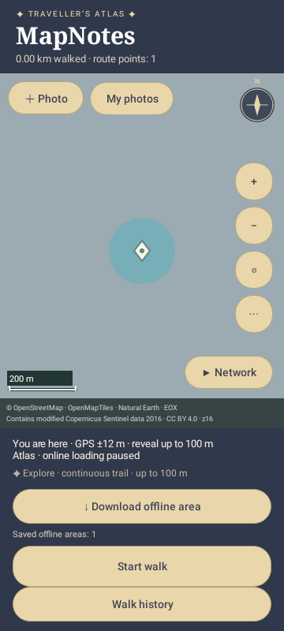
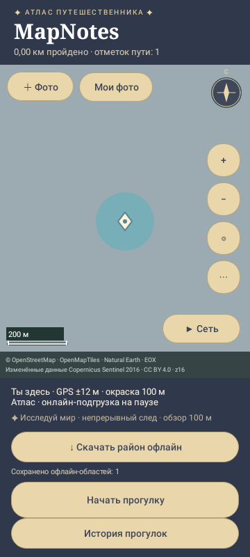

# MapNotes

An Android walking journal that turns your route into an explored map, with geotagged photos and private notes.

- Illustrated atlas and optional satellite layer; exploration follows your walks, with a 100 m maximum reveal radius and approximate building-wall occlusion.
- Foreground GPS recording, separate walk history, elapsed time and conservative recorded distance.
- Built-in Camera2 camera, photo-size selection, orientation handling and supported continuous camera light.
- Private photo viewer, notes, map markers and explicit export of a photo copy to the system gallery.
- Resumable regional atlas downloads; optional satellite downloads; read-only vector/raster MBTiles import.
- English and Russian, following the system language by default. Change it in **⋯ → App language**.

**Android 8.0+ (API 26); APK target API 35.** This is an independent walking journal, not turn-by-turn navigation or a safety/navigation instrument. Detailed world maps are not bundled in the APK.

## Install

Download `MapNotes-1.0.0.apk` and `SHA256SUMS` from the [1.0.0 release](https://github.com/dotliberty/MapNotes/releases/tag/v1.0.0). Compare the APK SHA-256 with the checksum file before installation, then allow installation from your chosen browser/file manager if Android asks.

**Existing MapNotes users: install over the previous version. Do not uninstall or clear app data.** The release keeps the `ru.main.explorer` package, existing signing certificate and SQLite v3 schema. Signing compatibility and migration logic are checked locally; an update of a real user's phone/database has not been exercised here. A separately signed local build cannot update the published APK.

There is no full route/photo backup or restore workflow. Uninstalling or clearing storage removes private data. Exporting photos to the system gallery is not a route/database backup.

## Screenshots

These are **Robolectric Canvas renders of the actual UI using synthetic test data**, not photographs of a physical Android device or a real user's route. They demonstrate the layouts and language variants; hardware camera preview is not simulated as a real camera image.

| English | Русский |
| --- | --- |
|  |  |

## First walk

1. Grant precise location access and enable system location/GPS.
2. Select **Start walk** for foreground recording, including while the screen is off subject to Android restrictions. A notification provides **Stop**.
3. Take a photo after a fresh location fix. Photos are private to MapNotes until you explicitly export a copy.
4. Finish the walk and open **Walk history** for recorded distance, elapsed time and photos from the full period.
5. For offline detail, download a small atlas region first (1–4 km is a sensible initial test) or connect a compatible local MBTiles file. Pause network activity separately from GPS recording.

Map display while the main screen is open can also record exploration points; those are not invented historical walk entries. Interrupted walks can be continued in a new route segment or ended explicitly. Elapsed time includes waiting and interruptions.

## Maps

The built-in Natural Earth data is a world overview, not detailed street coverage. Regional atlas downloads use OpenStreetMap geometry via public Overpass servers. Satellite imagery is the older EOX Sentinel-2 cloudless 2016 mosaic, roughly 10 m/pixel—not live or high-resolution imagery.

Compatible local `.mbtiles` files may contain raster tiles or MVT/PBF vector tiles with OpenMapTiles/Protomaps-style layers. The file picker first attempts read-only direct access. Providers that cannot support that require a copy into app storage, which needs additional disk space equal to the source file. PMTiles, Mapsforge `.map`, raw `.osm.pbf` and unextracted archives are not supported. Only one external MBTiles source is active at once. Satellite data is separate from a vector map.

Large regional downloads can take hours and depend on public server availability, storage and Android background limits. Partial files support continuation but do not mean the whole region is ready. No complete planet dataset is included or claimed to have been downloaded/tested.

## Privacy, tests and building

- [Privacy and permissions](docs/PRIVACY.md)
- [Build and test guide](docs/BUILDING.md)
- [Known limitations and verification scope](docs/KNOWN-LIMITATIONS.md)
- [Map data and third-party attribution](docs/ATTRIBUTIONS.md)
- [Source availability / licensing notice](LICENSE-NOTICE.md)

No account, analytics backend or automatic crash upload is implemented. Network map providers can see requested map areas and normal connection metadata. Routes, private photos and notes are stored on the device. See the privacy document for important exceptions and export implications.

## Source availability

This repository is public for inspection. **No general software license grant has been selected by the copyright holder.** Do not infer an MIT, Apache, GPL or other license from public visibility. Third-party map data and test fixtures retain their own terms. See `LICENSE-NOTICE.md`.
