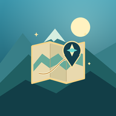
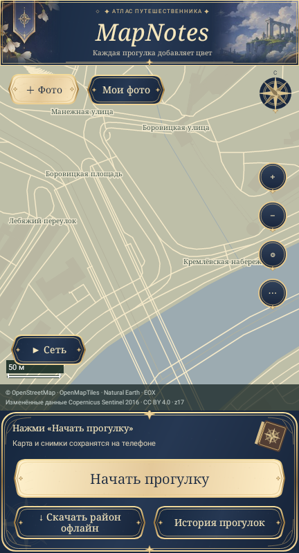
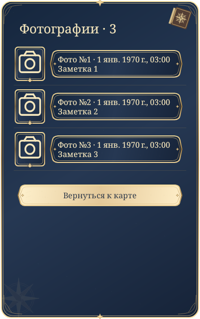
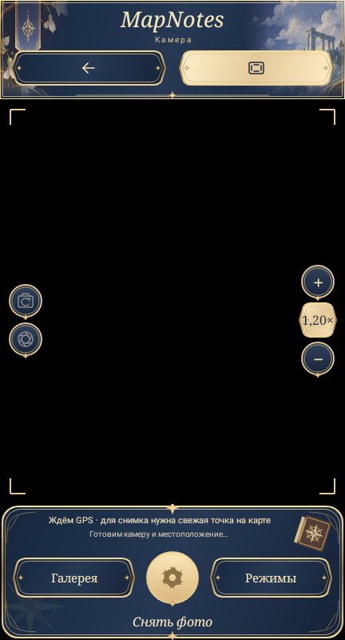

  

<h1 align="center">MapNotes</h1>

  <strong>Твои прогулки открывают карту.</strong> 
  Дневник прогулок для Android: маршруты, фотографии с привязкой к месту и личные заметки.

  <a href="https://github.com/dotliberty/MapNotes/releases/tag/v1.2.4">Скачать 1.2.4</a> ·
  <a href="#первая-прогулка">С чего начать</a> ·
  <a href="docs/1.2.4-RELEASE.md">Что нового</a> ·
  <a href="README.md">English</a>

Android 8.0+ · Русский / English · Без регистрации

---

## Дневник мест, в которых ты побывал

Начни прогулку, исследуй район и фотографируй интересные места. MapNotes записывает маршрут, раскрывает карту вокруг принятых точек прогулки и сохраняет фотографии и заметки с привязкой к месту.

Это дневник прогулок, а не планировщик маршрутов или пошаговый навигатор. Атлас показывает реальные картографические данные, а не вымышленный игровой мир.

### Что умеет приложение

- **Показывать исследованные места.** Карта раскрывается вдоль прогулки в радиусе до 100 м, приблизительно учитывая стены зданий. Масштабирование и перемещение по карте сопровождаются плавными переходами.
- **Хранить историю прогулок.** Начинай, завершай или продолжай прогулку, просматривай маршрут, прошедшее время и связанные фотографии. Во время записи отображается постоянное уведомление.
- **Сохранять фотографии вместе с местом.** Встроенная камера позволяет выбирать доступные объективы и размеры снимка, менять масштаб в пределах возможностей устройства. Открой фотографию с карты и добавь заметку.
- **Оставлять оригиналы внутри приложения.** Фотографии не попадают в системную галерею автоматически. Команда сохранения в галерею создаёт отдельную копию.
- **Работать с подготовленными картами без интернета.** Скачай район атласа или подключи совместимый локальный файл `.mbtiles`. Загрузку района можно приостанавливать и продолжать.
- **Работать на русском и английском.** Язык выбирается по системе или вручную через **⋯ → Язык приложения**.

## Как это выглядит

<table>
  <tr>
    <th>Карта</th>
    <th>Фотографии</th>
    <th>Камера</th>
  </tr>
  <tr>
    <td></td>
    <td></td>
    <td></td>
  </tr>
</table>

Это **рендеры настоящего интерфейса через Android Canvas в Robolectric**, а не скриншоты с физического телефона. Для карты использован сохранённый публичный векторный тайл Москвы, записи дневника — тестовые. Чёрная область камеры намеренная: тест раскладки не получает изображение с аппаратной камеры.

[Интерфейс на русском](docs/screenshots/main-ru.png) · [Интерфейс на английском](docs/screenshots/main-en.png)

## Установка и обновление

1. Открой [релиз 1.2.4](https://github.com/dotliberty/MapNotes/releases/tag/v1.2.4).
2. Скачай **`MapNotes-1.2.4.apk`**. Рядом лежит `SHA256SUMS` для проверки целостности скачанного файла.
3. Открой APK на Android и, если потребуется, разреши установку из своего браузера или файлового менеджера.

**Если официальная версия MapNotes уже установлена, устанавливай новую поверх неё. Не удаляй приложение и не очищай его данные.** Пакет и сертификат подписи официального релиза сохранены. APK с `-debug` в имени — отдельное тестовое приложение, а не обновление основной установки.

> Полного резервного копирования и восстановления дневника пока нет. Удаление приложения или очистка хранилища удаляют его личные маршруты, фотографии и заметки. Копия фотографии в галерее не является резервной копией дневника.

**Требования:** Android 8.0 или новее. Для раскрытия карты и фотографий с привязкой к месту нужны точная геолокация и включённое системное определение местоположения/GPS. Возможности камеры зависят от устройства.

## Первая прогулка

1. **Разреши точную геолокацию**, включи системное определение местоположения/GPS и дождись актуальной точки.
2. **Нажми «Начать прогулку».** Остановить запись можно из уведомления. Работа с погашенным экраном зависит от ограничений Android и производителя телефона.
3. **Нажми «+ фото»**, когда захочешь сохранить место. Для снимка нужна свежая точка геолокации; оригинал останется внутри MapNotes.
4. **Заверши прогулку.** Открой историю, чтобы просмотреть её, или выбери фотографию на карте, чтобы открыть снимок и изменить заметку.
5. **Подготовь подробную карту заранее.** Для первой офлайн-пробы скачай небольшой район 1–4 км или подключи совместимую MBTiles-карту.

Открытая карта может сохранять точки исследования и вне явно начатой прогулки. Эти точки не создают вымышленных записей в истории прогулок. Дистанция считается консервативно, а прошедшее время включает ожидание и перерывы.

## Карты и работа без интернета

В APK входит **обзорная карта мира**, а не подробная карта всей планеты. Улицы появляются из скачанных районов или подключённой карты.

| Источник | Что даёт |
| --- | --- |
| Встроенный обзор Natural Earth | Общие очертания мира без подробной уличной сети. |
| Скачанные районы атласа | Улицы и здания OpenStreetMap через публичные серверы Overpass. |
| Локальная карта `.mbtiles` | Растровые тайлы или поддерживаемые MVT/PBF-данные, включая совместимые слои OpenMapTiles/Protomaps; источник открывается только для чтения. |
| Дополнительный спутниковый слой | Мозаика EOX Sentinel-2 cloudless **2016 года**, примерно 10 м/пиксель, а не актуальная съёмка высокого разрешения. |

Уже скачанные данные можно просматривать без подключения к сети. Загрузки и онлайн-слои зависят от доступности внешних сервисов: публичные серверы могут ограничивать запросы или не отвечать. Приостановка сети не останавливает запись GPS.

MBTiles открывается напрямую, если это позволяет файловый провайдер Android. Иначе потребуется место для локальной копии. Одновременно активна одна внешняя карта. Импорт PMTiles, Mapsforge `.map` и сырых `.osm.pbf` не поддерживается.

[Источники и атрибуция](docs/ATTRIBUTIONS.md) · [Подробные ограничения](docs/KNOWN-LIMITATIONS.md)

## Приватность без регистрации

Маршруты, оригиналы фотографий и заметки хранятся на устройстве. В MapNotes не реализованы собственный сервер синхронизации, рекламные/аналитические SDK или автоматическая отправка отчётов об ошибках.

**Локальное хранение не делает онлайн-карты анонимными.** Картографические сервисы видят запрашиваемые области/тайлы, IP-адрес и обычные сведения о соединении. Фотография, экспортированная в системную галерею, может попасть в облачную копию по настройкам галереи.

[Прочитай описание приватности и разрешений](docs/PRIVACY.md), если собираешься хранить чувствительные координаты или фотографии.

## Состояние и ограничения

В 1.2.4 обновлены оформление и управление камерой, исправлены небезопасные переходы при её переключении, исходники приведены к единому читаемому формату.

Релизный прогон: **256 Android/JVM-тестов прошли**, **3 проверки внешних данных пропущены**, ошибок нет. Также прошли проверки форматирования, ресурсов, геометрии, метаданных и подписи. Это локальные программные проверки, **а не приёмка аппаратной камеры/GPS на телефоне и не гарантия частоты кадров**.

- Точность GPS и фоновая запись зависят от приёма, Android и производителя устройства.
- Объективы, масштаб, размеры снимков и подсветка доступны в пределах заявленных возможностей камеры.
- Раскрытие карты приблизительно оценивает видимость по двумерной геометрии: реальный рельеф и все преграды не моделируются.
- Большое количество фотографий и длинная история могут требовать времени на загрузку и перерисовку.
- MapNotes не предназначен для экстренной навигации и решений, от которых зависит безопасность.

Если обнаружишь ошибку, укажи модель устройства, версию Android/приложения и шаги воспроизведения. Локальный отчёт о сбое можно посмотреть и явно скопировать из меню карты; перед отправкой проверь, нет ли в нём личных сведений.

## Сборка, тесты и участие

Приложение написано на Java с использованием Android API. Отдельный тестовый проект использует Gradle/Robolectric. Инструменты, упаковка APK и подпись описаны в руководстве по сборке.

- [Сборка и тестирование](docs/BUILDING.md)
- [Стиль кода и проверка форматирования](docs/FORMATTING.md)
- [Описание релиза 1.2.4](docs/1.2.4-RELEASE.md)
- [Проверки интерфейса](docs/1.2.4-DESIGN.md) и [регрессии переключения камеры](docs/1.2.4-CAMERA-SAFETY.md)
- [Экспериментальная трассировка по снимкам](docs/IMAGERY-TRACE.md) — отдельная бета-функция; упоминания ранних версий в документе исторические.

Технические документы по ссылкам — на английском. При изменениях сохраняй EN/RU-строки, не смешивай посторонние правки и добавляй регрессионные тесты там, где это уместно. Не включай в коммиты личные ключи подписи, учётные данные, маршруты и фотографии. Сборка с другой подписью не обновит официальную установку приложения.

## Лицензия и источники

Оригинальный программный код распространяется по **[Mozilla Public License 2.0](LICENSE)**. Это не означает отдельного лицензирования картографических наборов данных и иллюстраций. См. [область действия лицензии и исключения](LICENSE-NOTICE.md), [атрибуцию данных](docs/ATTRIBUTIONS.md) и [происхождение декоративных изображений](assets/atlas124/SOURCES.md).
